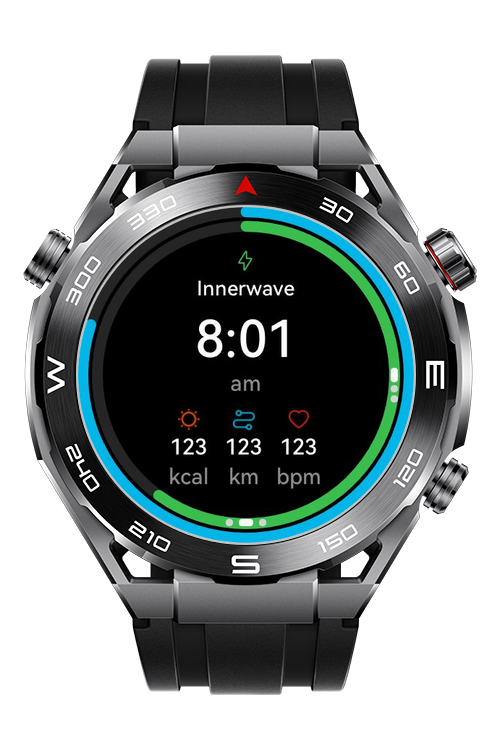
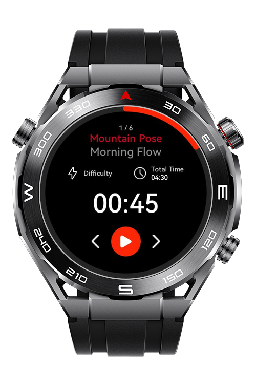
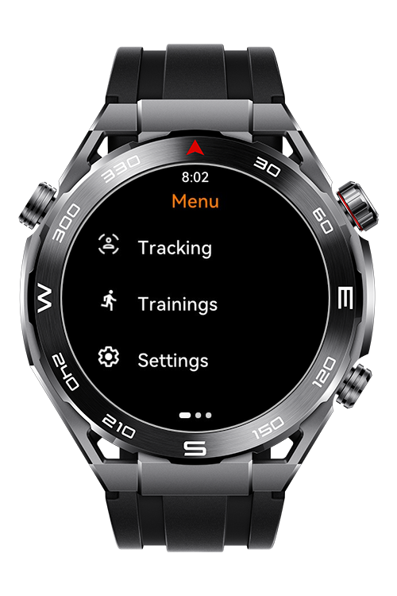
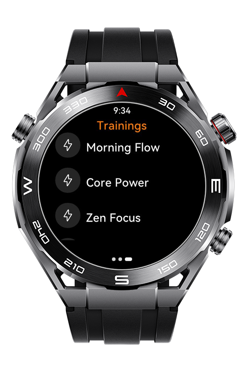

> **Note:** To access all shared projects, get information about environment setup, and view other guides, please visit [Explore-In-HMOS-Wearable Index](https://github.com/Explore-In-HMOS-Wearable/hmos-index).

# Sport Watch - InnerWave

**Sport Watch – InnerWave** is a HarmonyOS lite wearable sample application for Huawei sport watches that allows users
to track real time health metrics, manage training sessions, and customize activity goals through a simple swiper based
interface.

# Preview

<p align="left">
    
    
    
    
</p>

# Use Cases

1. **Splash Screen:** When the user opens the app, a Splash Screen displaying the InnerWave logo is shown. This screen
   informs the user that the application is loading. After a short delay, the app automatically navigates to the Main
   Page.
2. **Main Page(Swiper Structure):** The Main Page consists of a swiper with three pages. Users can swipe left or right
   to navigate between pages. This structure allows quick access to core features within a single, seamless interface.
3. **Trackings:** Users can view their tracking data on this screen. Historical activity and tracking information are
   displayed for easy review.
4. **Trainings:** Users can access the list of available training sessions. Training details can be viewed and managed
   from this page.
5. **Settings:** Users can configure vibration settings. Users can set or update their daily step goals. Personal
   preferences are managed from this section.
6. **Real-Time Health Monitoring:** This page displays the user’s live health metrics. Real-time heart rate is shown
   while the user is in motion. Calories burned are updated continuously. Users can instantly monitor their physical
   condition during daily activities or workouts.
7. **Training Control:** Users can view available training sessions on this page. A selected training can be:Started
   Paused or stopped Health data continues to be tracked during active training sessions. Users have full control over
   their workouts directly from this screen.

# Tech Stack

**Languages**: JS, ArkUI Lite  
**Frameworks**: HarmonyOS SDK 5.0.0(10)
**Tools**: DevEco Studio 6.0.0  
**Libraries/Kits**:

- @ohos.router
- @system.sensor
- @system.file
- @system.device
- @system.vibrator
- @system.brightness

# Directory Structure

```
entry\src\main\js
└───MainAbility
    │   app.js
    ├───common
    │   └───css
    │           common.css
    ├───utils
    │           utils.js
    └───pages
        ├───index
        │       index.css
        │       index.hml
        │       index.js
        └───mainPage
        │       mainPage.css
        │       mainPage.hml
        │       mainPage.js
        └───settings
        │       settings.css
        │       settings.hml
        │       settings.js
        └───training
        │       training.css
        │       training.hml
        │       training.js
```

# Constraints and Restrictions

## Permissions

1. **ohos.permission.READ_HEALTH_DATA**
2. **ohos.permission.ACTIVITY_MOTION**

## Supported Device
This app works on real device.

- Huawei Sport (Lite) Watch GT 4/5/6
- Huawei Sport (Lite) GT5/6 Pro
- Huawei Sport (Lite) Fit 3/4 & Fit 4 Pro
- Huawei Sport (Lite) D2
- Huawei Sport (Lite) Ultimate 1

# License

**Sport Watch – InnerWave** is distributed under the terms of the **MIT License**.  
See the [LICENSE](LICENSE) file for more information.  